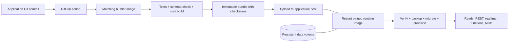

# Biralobase

PocketBase applications on the embedded Rust Turso engine, with Git-managed schema, asynchronous TypeScript functions, immutable application releases, and OAuth-protected MCP tools.

**Experimental development release.** The implementation has automated regression coverage, but production certification requires the native Linux matrix, container verification, and extended stability gates described in [testing](docs/testing.md). Turso MVCC is experimental; concurrent transactions can conflict. This project makes no claim of lock-free operation or a measured speedup over SQLite.

Biralobase forks PocketBase **v0.40.6**. The original history, MIT license, dashboard, API implementation, and regression tests are retained. [UPSTREAM.json](UPSTREAM.json) records the upstream revision. This is an independent Biralo Studio project, not an official PocketBase or Turso product.

## What is implemented

- Embedded Turso, `BEGIN CONCURRENT` for production writes, transaction cleanup, consistent backups, and one active process per data directory.
- A versioned `biralobase.schema.json`; generated, ordered, checksummed migrations; automatic startup application; backups before migration; metadata and physical-schema drift detection.
- Managed superuser creation and password rotation from environment variables or `_FILE` secrets, with a stable account ID.
- Node-based async TypeScript functions and npm dependencies, a bridge for all PocketBase hooks, transactional event delivery, retryable background jobs, and durable UTC schedules.
- Opt-in MCP tools generated from schema metadata, using OAuth authorization code + PKCE, explicit consent, refresh rotation, and PocketBase user permissions.
- A reusable runtime image and matching builder image. Application deployments upload a verified bundle and restart the same runtime image. Images change when Biralobase or its runtime dependencies change.

## Local development

Requirements: Go 1.27.4 and Node 26.13.1 (versions pinned for reproducibility). Linux/macOS amd64/arm64 are the intended native targets.

```sh
go build -o bin/biralobase ./cmd/biralobase
./bin/biralobase init ./my-app
cd my-app
npm install
npm run build
export BIRALOBASE_ADMIN_EMAIL=admin@example.com
export BIRALOBASE_ADMIN_PASSWORD_FILE=/absolute/path/to/your/private/password-file
../bin/biralobase --app-dir . --data-dir ./bb_data serve --dev
```

Commit `package-lock.json`. The dashboard is at `http://127.0.0.1:8090/_/`. Development mode permits dashboard schema/settings edits and uses exclusive transactions for DDL. Stop the process before exporting dashboard changes:

```sh
../bin/biralobase --app-dir . --data-dir ./bb_data schema export
../bin/biralobase --app-dir . schema generate
../bin/biralobase --app-dir . schema check
```

Review and commit the schema and generated `migrations/*.json`. The next development startup reconciles already-applied dashboard changes only when they exactly match the generated schema. Alternatively, edit the versioned schema directly, generate migrations, and restart. Keep collection and field IDs stable to preserve data across renames.

## Deployment



No application image build is required. Runtime and builder must have the same Biralobase version, platform, Node ABI, and compatible Linux base. Native npm dependencies are built on the target architecture.

See [deployment](docs/deployment.md) for the Compose configuration and application GitHub Action template, [application development](docs/application.md) for schema/functions/MCP, and [testing](docs/testing.md) for the compatibility and release gates. The [second reviewer briefing](docs/reviewer-handoff.md) records the real-application qualification, fixes, deployed test environment, and remaining release blockers.

## Development checks

```sh
go test -p 2 ./...                         # SQLite reference + new features
go test -p 2 -tags turso -timeout 25m ./... # upstream suite on Turso
go test -race -p 2 ./internal/... ./storage/...
go test ./internal/schema -run '^$' -fuzz FuzzDecodeSchema -fuzztime 30s
./scripts/test-js-sdk.sh
./scripts/test-dart-sdk.sh
```

The SDK scripts default to immutable production bundles with concurrent writes. `BIRALOBASE_TEST_MODE=dev` also exercises mutable dashboard behavior. Dart is needed for the Dart suite.

Use the Biralobase executable for the assembled product. The inherited root Go library and `examples/base` remain useful for upstream compatibility testing; their default driver is SQLite unless built with `-tags turso`.
